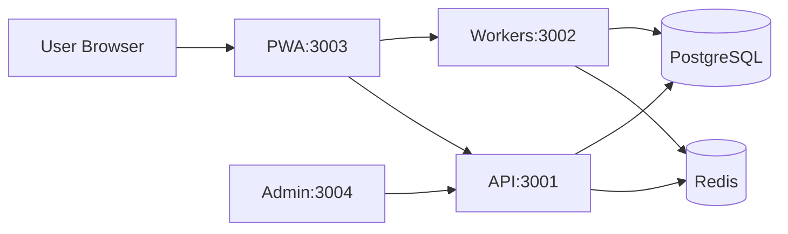
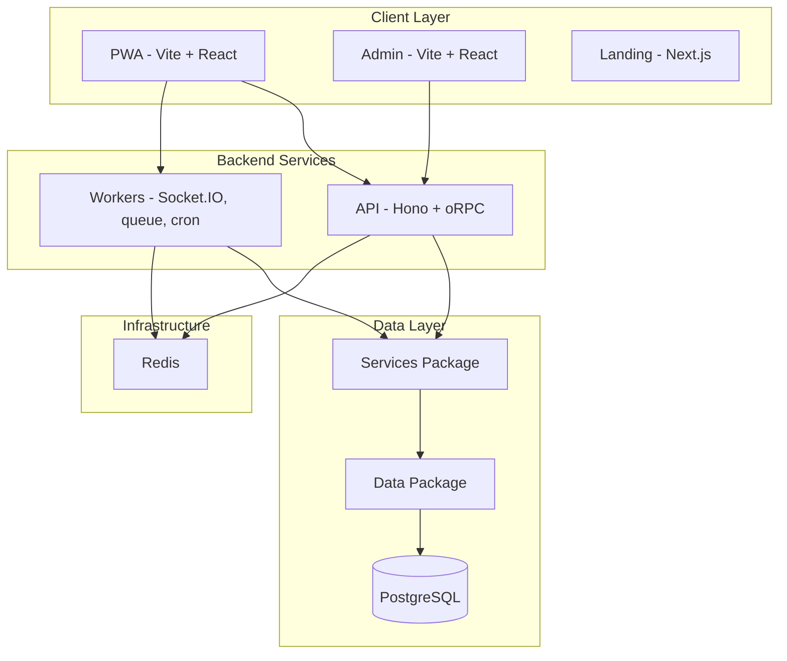

# Tab

Split expenses with friends. Open source, self-hostable, and built for the long run.

Tab is a Splitwise alternative that puts you in control. Your data stays on your server. No paywalls, no feature limits, no surprises. Run it yourself or contribute to make it better.

## Hosted Version

**A fully free**, donations-supported instance is available at [TabIt.in](https://tabit.in). No paywalls, no paid-only features. Free forever, as a way of giving back to the open source community. If it helps you, consider [supporting](https://tabit.in/support).

## Why Tab?

Commercial expense-splitting apps can change the rules overnight. Free tiers get restricted. Features move behind paywalls. Your years of expense history become leverage.

**Tab is different.**

- **Your data, your server** - Self-host and your expenses never leave your infrastructure. No third party has access to your financial data.

- **No vendor lock-in** - Open source means you are never at the mercy of pricing changes or policy shifts. The code is yours to run, fork, and modify.

- **Transparency** - You can read the code, audit the logic, and know exactly what is running. No black boxes.

- **Community-driven** - Features are built by users, for users. Report issues, suggest improvements, or contribute code. The project improves when the community contributes.

- **Run it forever** - Even if the maintainers move on, the source remains. You or any developer can keep it running. No one can take it away.

## Features

### Core Splitting

- [x] 1-on-1 and group expense tracking
- [x] Split types when adding or editing: equal (default), custom amounts per person, percentages (must total 100%), and shares; expense detail shows how each share was set
- [x] Multi-currency tabs and expenses
- [x] Recurring expenses per tab (interval, monthly, weekly weekdays), pause/resume, FX per occurrence, tab list shows recurring-linked expenses
- [x] Splitwise CSV import
- [x] Expense audit logs

### Modern Experience

- [x] Progressive Web App (install on iOS, Android, desktop)
- [x] AI-powered voice expense entry
- [x] Real-time notifications via Socket.IO and web push
- [ ] Offline-first with IndexedDB persistence
- [x] Emoji reactions on expenses

### Social and Collaboration

- [x] **Placeholder friends** on group tabs: add named stand-ins before someone has an account or joins the tab; they count in splits, settlements, recurring rules, and balances like members. Tab owners can **merge** a placeholder into a real member in one step (history and ledger move over). Managed from the tab **Members** screen in the PWA.
- [x] QR code invites for friends and tabs
- [x] Poke friends for fun
- [x] Payment reminders on direct tabs (Remind when you are owed; friend receives web push `payment_reminder`; choose tone in the PWA)
- [x] Sort friends and tabs by name, recency, or activity

### Privacy and Control

- [x] Self-hostable
- [x] Magic link authentication (no passwords to manage)
- [x] Your data stays on your server

## Quick Start

For local development:

**Prerequisites:** Node.js 26+, pnpm 10, PostgreSQL, Redis, [Doppler CLI](https://docs.doppler.com/docs/install-cli) (dev scripts run through `doppler run`)

```bash
# 1. Install dependencies
pnpm install

# 2. Build shared packages
pnpm build:packages

# 3. Configure environment
cp .env.example .env
# Edit .env with DATABASE_URL, REDIS_URL, BETTER_AUTH_SECRET, SEQUENZY_API_KEY, CORS_ORIGIN, etc.
# Or load the same values into Doppler with `doppler setup` in each app.

# 4. Push the schema to your database
pnpm db:push

# 5. Start dev servers (api, workers, pwa)
pnpm dev

# 6. Run tests
pnpm test
```

The app runs at:

- PWA: http://localhost:3003
- API: http://localhost:3001
- Workers (Socket.IO realtime): http://localhost:3002
- Admin console: http://localhost:3004 (`pnpm dev:admin`)
- Landing page: http://localhost:3000 (`pnpm dev:web`)

## Self-Hosting with Docker Compose

Deploy Tab on your own infrastructure. You provide PostgreSQL and Redis; Docker Compose builds and runs the api, workers, pwa, and admin services from [cloud-docker-compose.yml](cloud-docker-compose.yml).

### Prerequisites

- Docker and Docker Compose (BuildKit enabled)
- PostgreSQL database (managed service like Neon, Supabase, or self-hosted)
- Redis
- Email service for magic links (Sequenzy)
- Domain name (optional but recommended for production)

### Step 1: Clone and Configure

```bash
git clone https://github.com/incentyvise/tabit.git
cd tabit
cp .env.example .env
```

### Step 2: Set Environment Variables

Edit `.env` with your values. Required variables:

| Variable              | Description                                              |
| --------------------- | -------------------------------------------------------- |
| Variable              | Description                                              |
| --------------------- | -------------------------------------------------------- |
| `DATABASE_URL`        | PostgreSQL connection string                             |
| `REDIS_URL`           | Redis connection string                                  |
| `BETTER_AUTH_SECRET`  | Secret for auth (min 32 characters)                      |
| `VITE_API_URL`        | API URL (e.g. https://api.yourdomain.com)                |
| `VITE_REALTIME_URL`   | Workers Socket.IO URL (e.g. https://wrk.yourdomain.com)  |
| `SEQUENZY_API_KEY`    | Sequenzy API key for OTP emails                          |
| `CORS_ORIGIN`         | Allowed origins for API and workers (your PWA URL)       |
| `NEXT_PUBLIC_PWA_URL` | Public PWA URL                                           |
| `ADMIN_EMAILS`        | Emails allowed into the admin console                    |

The PWA and admin are static Vite bundles, so their `VITE_*` values are baked in at build time (via Doppler build args `DOPPLER_TOKEN_PWA` / `DOPPLER_TOKEN_ADMIN`, or build args in the compose file). The api and workers read their env at runtime.

Optional: `VAPID_PUBLIC_KEY`, `VAPID_PRIVATE_KEY`, `VITE_VAPID_PUBLIC_KEY` for web push; `DISCORD_WEBHOOK_URL` for ops alerts; `GOOGLE_GENERATIVE_AI_API_KEY` for AI expense parsing; `TIMEZONE_IP_LOOKUP=0` on the API to skip optional IP-based timezone suggestion for profile preferences (proxy headers such as `CF-Timezone` are still honored when present).

### Step 3: Start the Stack

```bash
docker compose -f cloud-docker-compose.yml up -d --build
```

The API container runs database migrations before it starts listening. The api and workers expose `/health` for container health checks.

### Step 4: Access the App

The compose file exposes services on an internal network. To access the PWA:

**Option A: Reverse proxy (recommended for production)**

Place Caddy or Nginx in front. Route your domain to:

- PWA: `pwa:3003` (e.g. app.yourdomain.com)
- API: `api:3001` (e.g. api.yourdomain.com; serves oRPC at `/rpc` and Better Auth at `/api/auth`)
- Workers: `workers:3002` (e.g. wrk.yourdomain.com; Socket.IO, needs WebSocket upgrade)
- Admin: `admin:3004` (e.g. admin.yourdomain.com)

**Option B: Port mapping (local testing)**

In `cloud-docker-compose.yml`, add `ports` to the services you want to reach, for example under `pwa`:

```yaml
ports:
  - "3003:3003"
```

Then open http://localhost:3003

### Architecture



### Production Considerations

- Use a reverse proxy (Caddy, Nginx) with SSL/TLS
- Set `BETTER_AUTH_COOKIE_DOMAIN` and `BETTER_AUTH_TRUSTED_ORIGINS` for your domain
- Configure backups for PostgreSQL
- Consider `OTEL_*` variables for observability (SigNoz, etc.)

## Development

### Project Structure

Monorepo (Turborepo):

- `apps/pwa` - Main expense app (Vite + React), port 3003
- `apps/api` - Hono + oRPC API, port 3001
- `apps/workers` - Socket.IO realtime, notification queue, web push, and cron jobs (recurring expenses, FX rates), port 3002
- `apps/admin` - Admin console (Vite + React), port 3004
- `apps/web` - Landing page (Next.js, hosted separately)
- `packages/services` - Business logic
- `packages/data` - Data access layer
- `packages/db` - Drizzle schema and migrations
- `packages/rpc` - oRPC router and procedures
- `packages/auth` - Better Auth setup
- `packages/models` - Shared types and Zod schemas
- `packages/queue` - BullMQ queues
- `packages/otel` - OpenTelemetry logging and tracing
- `packages/shared` - Shared utilities

### Commands

```bash
pnpm dev              # Start api, workers, and pwa
pnpm dev:admin        # Start the admin console
pnpm dev:web          # Start the landing page
pnpm test             # Run all tests
pnpm check            # TypeScript check
pnpm lint             # ESLint
pnpm build            # Build for production
```

### HTTPS for Local PWA

```bash
pnpm generate-https-certs   # Requires mkcert
```

## Architecture



- Service layer for business logic (validation, authorization, notifications)
- Data layer for database queries
- Notifications go through a BullMQ queue to the workers, which deliver them over Socket.IO and web push
- PWA with offline-first IndexedDB cache

## Tech Stack

**Frontend**

- React 19 + Vite
- TanStack Router + TanStack Query (IndexedDB persistence)
- Zustand for UI state
- PWA with service workers

**Backend**

- Hono + oRPC
- Better Auth (magic links only)
- Drizzle ORM + PostgreSQL
- Redis + BullMQ for queues and caching
- Socket.IO for realtime, Web Push for notifications

**Infrastructure**

- Docker + Docker Compose (Dokploy)
- Doppler for secrets
- Turborepo monorepo
- Vitest for testing
- OpenTelemetry (optional)

**Integrations**

- Google Gemini for AI expense parsing
- Sequenzy for transactional emails

## Open Source Shoutouts

Tab and related projects (Snitchfeed, Conncord) are built with and deployed using these open source tools:

- [Sequenzy](https://sequenzy.com/) - Email platform for transactional and marketing email.
- [SigNoz](https://signoz.io) - Open-source observability platform. Logs, traces, and metrics in one place.
- [Dokploy](https://dokploy.com) - Self-hosted PaaS for deploying applications with Docker Compose.
- [Bull Board](https://github.com/felixmosh/bull-board) - Queue background jobs inspector for Bull and BullMQ.

## Contributing

Contributions are welcome. Open an issue to report bugs or suggest features. Pull requests should include tests where applicable.

## License

See the LICENSE file in the repository.
